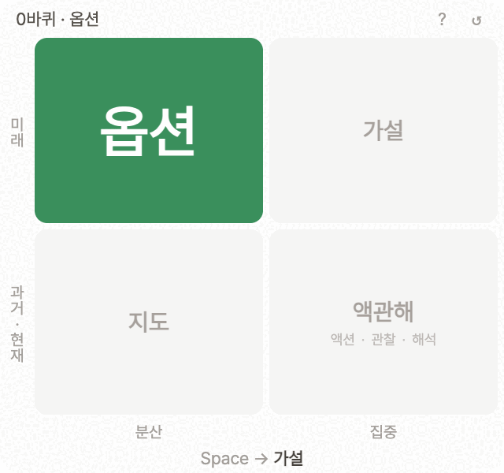
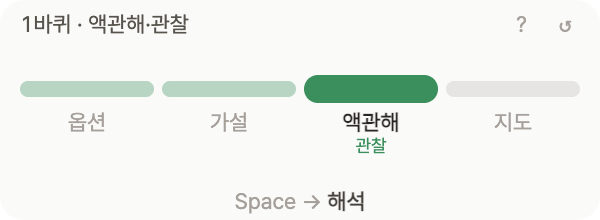
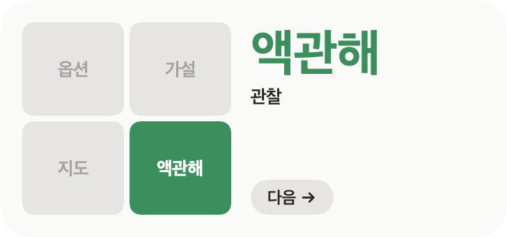

# 야생학습 (wild-learning)

김창준의 "야생 학습의 네 가지 모드"를 사분면으로 그려, 지금 주의가 어느 모드에 있는지 보여 주는 macOS 위젯 앱과 웹앱.



김창준의 『야생 학습』(인사이트, 2026)에 나오는 개념으로 만든 개인 프로젝트다. 저자, 출판사와는 관계가 없다. 아이콘은 책 표지의 분위기를 따라 새로 그렸다.

네 모드는 옵션, 가설, 액관해, 지도다. 액관해 모드는 액션, 관찰, 해석 세 단계로 나뉜다. 그래서 주의는 옵션 → 가설 → 액션 → 관찰 → 해석 → 지도 → 옵션, 여섯 단계를 돈다.

- 지금 모드의 칸이 초록으로 칠해지고 모드 이름이 크게 보인다. 액관해 칸에는 액션, 관찰, 해석이 작게 보이고, 지금 단계에 밑줄이 그어진다.
- Space를 누르면 다음 단계로 간다. 액션, 관찰, 해석은 한 번만 돌고 지도로 넘어간다.
- 칸을 누르면 그 모드로 간다. 액션, 관찰, 해석을 다시 돌고 싶으면 액관해 칸 안의 단계 이름을 누른다.
- 위쪽 줄에 바퀴 수와 지금 단계가 보인다. 지도에서 옵션으로 넘어갈 때마다 한 바퀴로 센다.
- 경과 시간은 화면에 띄우지 않는다. 시간이 보이면 주의가 모드보다 시계로 가기 때문이다. 단계를 옮긴 시각은 세션 기록에 남는다.
- ↺ 버튼은 기록을 지우고 새 세션을 시작한다. 세션은 localStorage에 남아서, 다시 열어도 이어진다.
- `?` 키나 위쪽 `?` 버튼으로 사용법을 연다. 처음 실행하면 한 번 저절로 열린다. 데스크톱에서는 따로 창으로 뜨고, 웹에서는 페이지 위에 겹쳐 뜬다. Esc로 닫는다.



데스크톱 앱에만 있는 기능은 다음과 같다.

- 위젯 창은 처음에 다른 창 위에 떠 있다. 위쪽 줄을 끌어 옮기고, 오른쪽 아래 모서리를 끌어 크기를 바꾼다(최소 200×90). 높이가 170px보다 낮거나 너비가 240px보다 좁으면 네 칸짜리 한 줄 막대로 바뀐다.
- macOS 메뉴 막대에 지금 단계가 초록 배지로 보인다. 액관해 모드에서는 `액션`, `관찰`, `해석`처럼 지금 단계만 보인다.
- 메뉴 막대 메뉴에는 항상 위에 표시, 사용법, 종료가 있다. 항상 위에 표시를 끄면 위젯 창이 다른 창 뒤로 갈 수 있고, 이 설정은 다음 실행에도 유지된다.
- 알림센터 위젯(작은 크기, 중간 크기, macOS 14 이상)에서도 지금 단계를 보고 `다음 →`으로 넘길 수 있다. 알림센터 위젯은 앱이 켜져 있을 때만 단계를 보여 주고, 앱을 끄면 "앱을 실행해 주세요"로 바뀐다.

| 메뉴 막대 배지 | 알림센터 위젯 (작은 크기) | 알림센터 위젯 (중간 크기) |
| --- | --- | --- |
|  |  |  |

### 설치

[Releases](https://github.com/younggeun0/wild-learning/releases)에서 `wild-learning_<버전>_arm64.dmg`를 받아 `wild-learning.app`을 Applications로 옮긴다. Finder와 메뉴에는 `야생학습`으로 보인다. 공증하지 않은 빌드는 처음 열 때 Gatekeeper가 막는다. 이때는 시스템 설정 > 개인정보 보호 및 보안에서 "그래도 열기"를 누른다.

알림센터 위젯은 앱을 한 번 실행한 뒤 알림센터 아래의 "위젯 편집"에서 `야생학습`을 찾아 추가한다.

### 단축키

| 단축키 | 설명 |
| --- | --- |
| `Space` | 다음 단계 |
| `shift + space` | 마지막 이동 되돌리기 |
| `cmd + shift + space` | 다른 앱을 쓰는 중에도 다음 단계 (데스크톱) |
| 칸이나 단계 이름 클릭 | 그 모드나 단계로 이동 |
| `?` | 사용법 열고 닫기 |

### 개발

Rust(`rustup`)와 Node 22 이상이 필요하다. 데스크톱 빌드에는 Xcode, `xcodegen`(`brew install xcodegen`), 키체인의 Developer ID Application 인증서도 필요하다.

```sh
npm install
npm run dev        # tauri dev
npm test           # vitest (세션 reducer)
npm run build      # scripts/build-mac.sh: 앱 빌드, 알림센터 위젯(widget/) 넣기, 서명, dmg. NOTARY_PROFILE이 있으면 공증
npm run build:web  # 웹앱을 dist에 빌드 (Vercel용, npx vite preview로 확인)
```

웹앱은 같은 renderer를 Tauri 브리지 없이 띄운다. `window.wildLearning`이 없으면 전역 단축키, 창 크기 손잡이, 메뉴 막대 배지가 빠진다.

알림센터 위젯은 `widget/`의 WidgetKit 확장이다. 앱과 위젯은 앱 그룹 컨테이너의 파일로 상태를 주고받는다. 앱은 지금 단계를 `stage.json`에 쓰고, 위젯의 다음 버튼은 `requests/*.advance` 파일을 남긴다. `npm run dev` 빌드에는 확장이 들어 있지 않아서 이 연동이 꺼진다. 알림센터에 올리지 않고 위젯 모양만 보려면 `scripts/render-widget.sh`를 실행한다. `.verify/widget-*.png`로 그려 준다.

- 앱 묶음 파일 이름(`productName`)은 영문 `wild-learning`으로 둔다. 경로에 한글이 들어가면 ExtensionKit이 위젯 확장을 찾지 못해서 위젯이 갱신되지 않는다. 화면에 보이는 이름 `야생학습`은 `src-tauri/Info.plist`와 `src-tauri/InfoPlist.strings`에서 정한다.
- 직접 서명해 빌드하려면 앱 그룹 ID 앞의 Team ID(`TFLHLW3C9D`)를 자기 Team ID로 바꾼다. `src-tauri/src/widget.rs`, `src-tauri/wild-learning.entitlements`, `widget/WildLearningWidget.entitlements`, `widget/Sources/Stage.swift` 네 곳이 같은 값을 쓴다.
- 앱 아이콘 원본은 `scripts/icon.html`이다. 파일 안 주석대로 1024px PNG를 만든 뒤 `npx tauri icon`으로 `src-tauri/icons`를 다시 만든다.

### 라이선스

[MIT](LICENSE). 웹 글꼴 Pretendard는 SIL Open Font License 1.1을 따른다.
